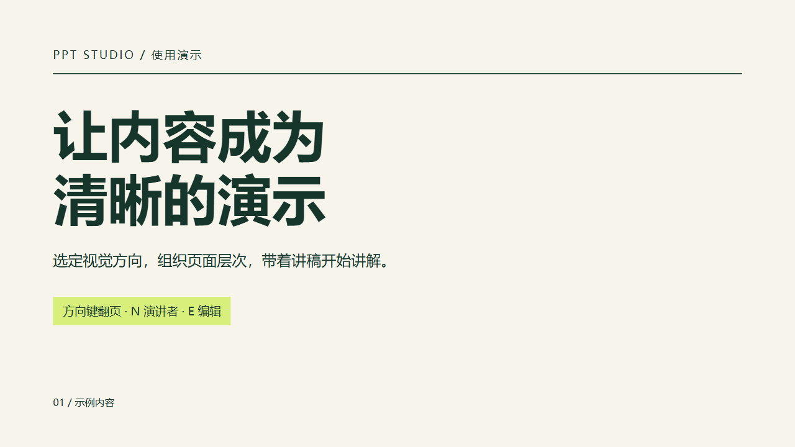
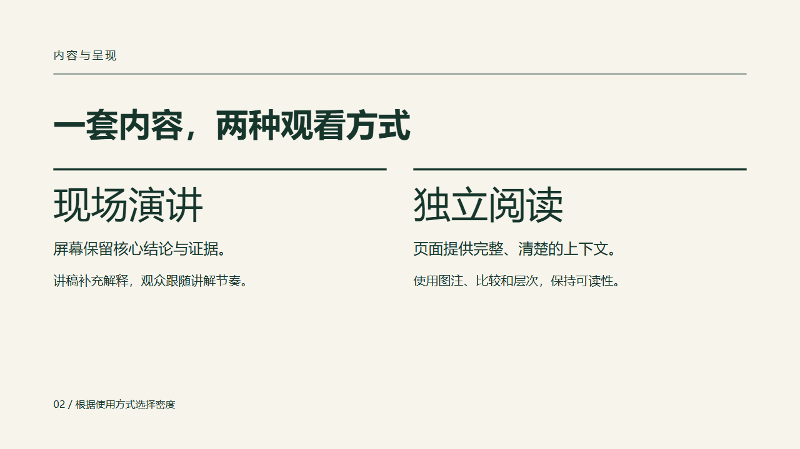
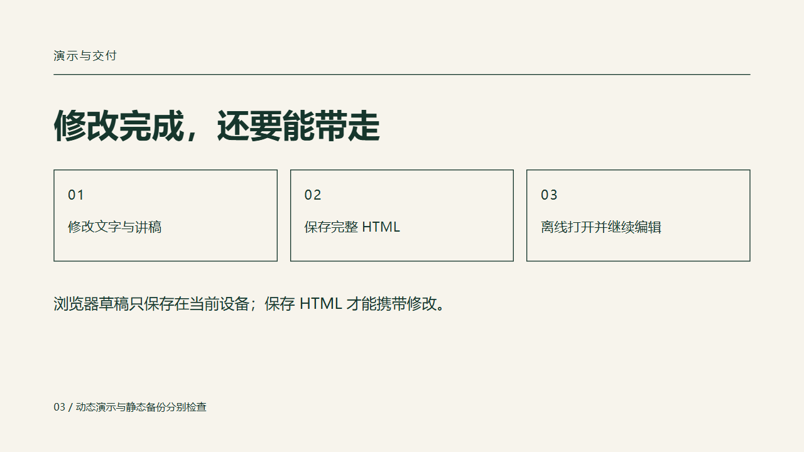
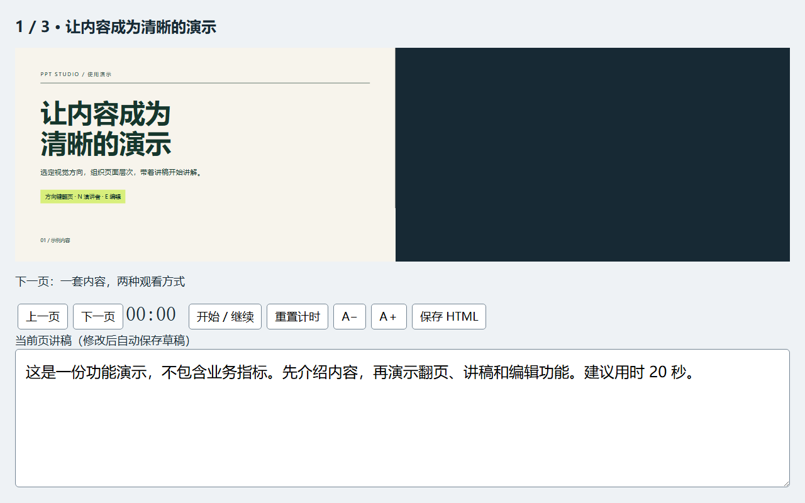
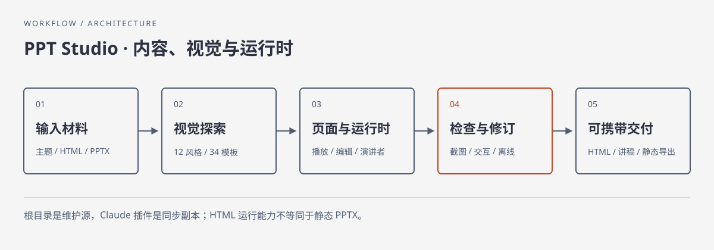

# PPT-Slides

**把主题、资料或旧 PPT，做成可演讲、可编辑、可带走的 HTML 幻灯片。**

PPT Studio 是面向编码 Agent 的演示制作技能。先用真实内容选视觉方向，再生成页面与逐页讲稿；演讲者窗口、计时、文字编辑和离线保存由同一套运行时提供。

[快速开始](#快速开始) · [实际效果](#实际效果) · [安装](#安装到你的-agent) · [工作方式](#工作方式) · [验证与边界](#验证与边界)



## 实际效果

这里展示的是仓库 [starter 源文件](examples/starter.html) 经 `scripts/bundle.py` 打包后的真实浏览器截图。示例用于展示排版和交互，不包含虚构业务指标，也不代表所有模板都已验收。

| 内容页 | 交付页 |
|---|---|
|  |  |



下载 [完整单文件演示](docs/demo.html) 后用浏览器打开即可体验；GitHub 的文件页只显示源码。播放不需要 Node.js、Python 或联网。

## 你会得到什么

| 能力 | 使用方式 |
|---|---|
| 从资料组织演示 | 输入主题、原稿、已有 HTML 或 PPTX；内容与讲稿按稳定页面 ID 对齐 |
| 先看真实样页 | 12 种基础风格、34 套设计模板，也支持按用户参考自由设计 |
| 上台讲解 | 键盘/触摸翻页，独立演讲者窗口，双向翻页，讲稿字号与计时 |
| 继续修改 | 编辑页面文字和讲稿，保留浏览器草稿，保存可携带的完整 HTML |
| 静态备份 | PDF；按需导出保留部分原生文字和形状的 PPTX |

它适用于教学、技术分享、汇报和路演。HTML 是主要交付格式；如果你需要完整原生 PowerPoint 动画或复杂图表编辑，请先确认导出边界。

## 快速开始

把本仓库完整目录交给有文件读写能力的 Agent，并发出：

```text
使用这个仓库的 SKILL.md，把附件整理成一份 10 分钟中文汇报。
先给我三种真实内容样页；选定后完成整套页面和逐页讲稿，
交付离线 HTML 和 PDF，并检查修改后重新打开是否保留内容。
```

已有风格和旧稿时，直接提供；无需重复选择设计方向。只复制 `SKILL.md` 会缺少模板、运行时和参考文件。

## 安装到你的 Agent

在目标项目根目录选一种方式执行；目标目录已存在时先比较版本，不覆盖现有修改。

**Codex**：

```sh
git clone https://github.com/2kilo3/PPT-Slides.git .agents/skills/ppt-studio
```

调用 `$ppt-studio`。**Claude Code 独立技能**：

```sh
git clone https://github.com/2kilo3/PPT-Slides.git .claude/skills/ppt-studio
```

调用 `/ppt-studio`。也可使用仓库现有 Claude 插件打包：先发送 `/plugin marketplace add https://github.com/2kilo3/PPT-Slides`，完成后再单独发送 `/plugin install ppt-studio@ppt-studio`，调用 `/ppt-studio:ppt-studio`。

**DeepSeek harness (dsh)**：将完整仓库克隆到 `.dsh/skills/ppt-studio`；默认本地提供方也能读取 `.agents/skills`。需启用技能注册表、文件系统提供方和对应工具。其他 Agent 可显式读取 `SKILL.md` 及其相对引用。加载路径依据见 [来源记录](docs/sources.md)；Claude/dsh 宿主安装尚未端到端实测。

## 工作方式



1. 从材料中确定受众、目标、时长与主要结论。
2. 用真实内容生成风格样页，选定后保持同一套视觉规则。
3. 生成带稳定 ID 的页面、文字编辑字段与逐页讲稿，接入共享运行时。
4. 检查截图、离线资源、翻页、演讲者同步、编辑和保存后重开。
5. 交付 HTML、讲稿和可用的静态备份，说明实际检查范围。

写作环节已吸收 Humanizer-zh 和 anti-defensive-writing 的适用规则：去掉空话和重复，围绕证据组织讲述，保留事实、条件和局限。无需额外安装这两个技能。

## 风格资源

| 方向 | 示例 | 入口 |
|---|---|---|
| 基础风格 | Paper & Ink、Swiss Modern、Neon Cyber | [12 种风格](STYLE_PRESETS.md) |
| 设计模板 | BlockFrame、Cobalt Grid、Signal | [34 套模板索引](bold-template-pack/selection-index.json) |
| 自由设计 | 使用你的品牌、参考页或主题 | 先看封面与代表性内容页，再扩展整套 |

模板提供设计规则，并非一键保证每种内容都适配的完整成品。更换内容后仍需逐页查看。

## 本地制作与检查

播放最终 HTML 只需现代浏览器。打包脚本使用 Python 3.10+ 标准库；浏览器检查及 PDF/PPTX 导出需要 Node.js 20+、锁定的开发依赖和 Chromium。提取现有 PPTX 另需 `python-pptx`。首次安装依赖需要网络。

```sh
npm ci --ignore-scripts
npx --no-install playwright install chromium
python scripts/bundle.py examples/starter.html work/demo.html
node scripts/check-deck.cjs work/demo.html work/qa --pdf --pptx
npm test
```

Windows 可用 `py -3` 替代 `python`，macOS/Linux 可用 `python3`。PowerShell 若限制 npm 脚本，使用 `npm.cmd` / `npx.cmd`。字体采用系统回退；要稳定复现中文排版，使用已获授权且目标设备可用的字体。浏览器检查会执行输入 HTML，请只检查自己制作或已审查的文件。

`npm test` 内部需要名为 `python` 的命令。只有 `python3` 的 POSIX 环境可依次运行下面的等价检查；`PYTHON` 也会传给浏览器回归里的 Python 子进程：

```sh
export PYTHON=python3
python3 -m unittest discover -s tests -p 'test_*.py'
node tests/export-server.cjs
node tests/runtime.cjs
node tests/exports.cjs
```

Windows 只有启动器时，先用 `$env:PYTHON = py -3 -c "import sys; print(sys.executable)"` 取得解释器路径，再以 `& $env:PYTHON -m unittest discover -s tests -p 'test_*.py'` 运行 Python 检查，最后依次运行上述三个 Node 检查。

| 按键 | 动作 |
|---|---|
| 方向键 / Space | 翻页 |
| N / F | 演讲者窗口 / 全屏 |
| E / Escape | 开始 / 结束编辑 |
| Ctrl/Cmd + S | 保存包含修改的 HTML |

浏览器草稿只属于当前设备，保存 HTML 才能带走修改。后续让 Agent 修改时，应提供最新导出的文件。

## 验证与边界

最新检查见 [VALIDATION.md](VALIDATION.md)，安全审查与可公开范围见 [安全说明](docs/security-review.md)。本仓库没有后台上传服务。可选部署工具属于显式发布动作，具体授权、依赖与目录要求见 [导出说明](references/export.md)。

PDF/PPTX 是静态交付；PPTX 只对支持的文字和基本形状保留原生编辑，复杂视觉可能栅格化。浏览器动画、演讲者模式不进入 PPTX。未把所有模板、浏览器、操作系统与投影设备的表现视为已验证。

## 维护与许可

根目录是唯一维护源。修改技能资源后运行：

```sh
python scripts/package_skill.py
python scripts/package_skill.py --check
```

Claude 插件副本由上述脚本同步。许可为 [MIT](LICENSE)；保留 frontend-slides 和模板作者声明。写作指导来源的许可见 [THIRD_PARTY_NOTICES.md](THIRD_PARTY_NOTICES.md)。第三方字体、媒体和用户材料各自保留原许可。

设计与实现来源见 [UPSTREAM.md](UPSTREAM.md)，README 参考依据见 [sources.md](docs/sources.md)。
